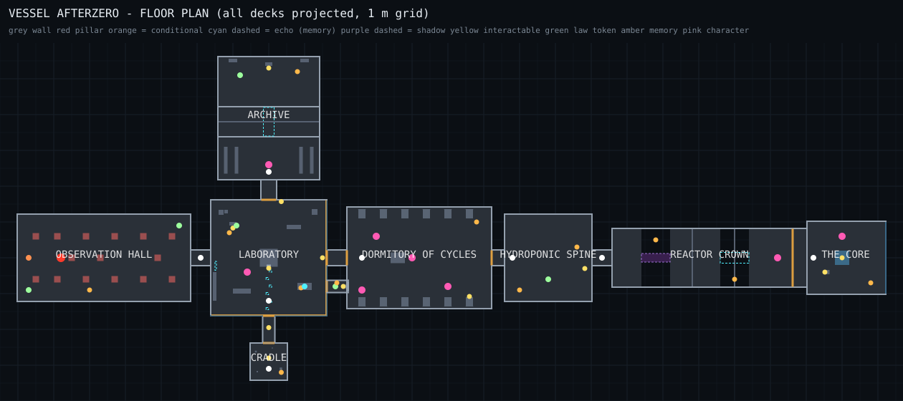
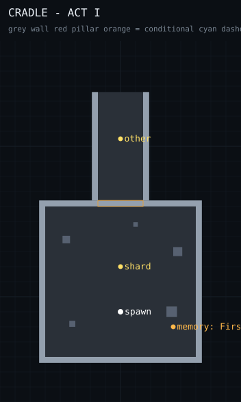
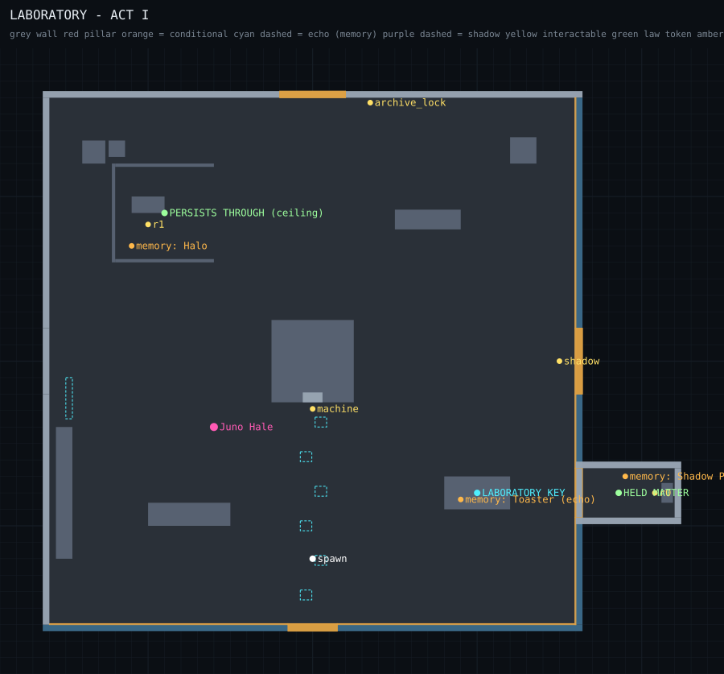
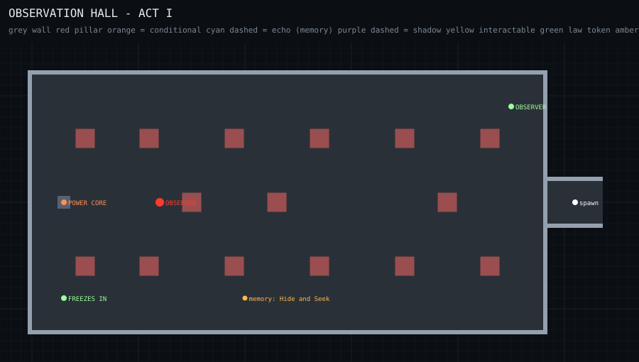
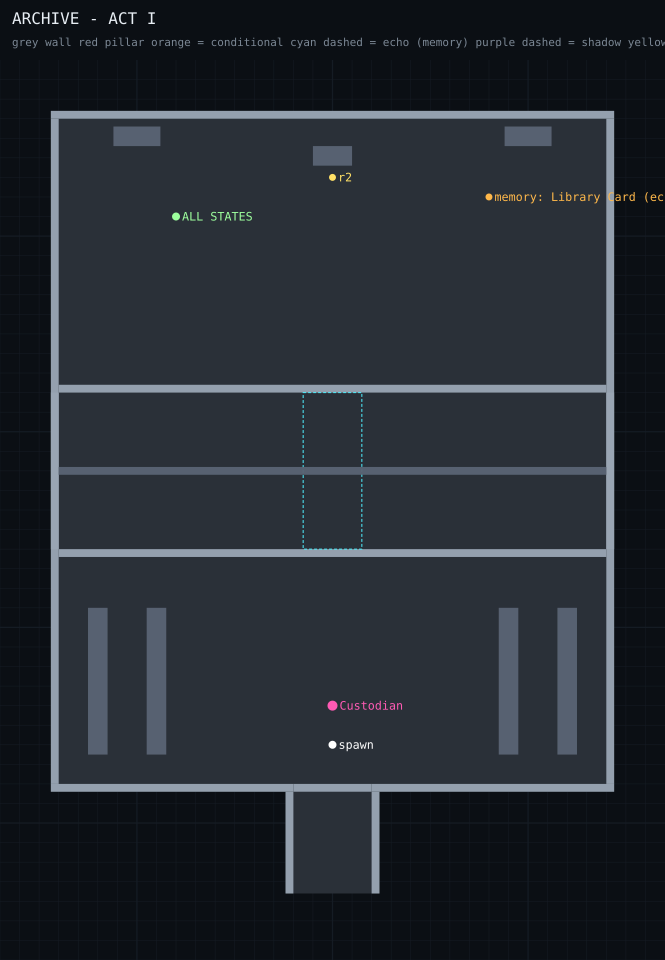
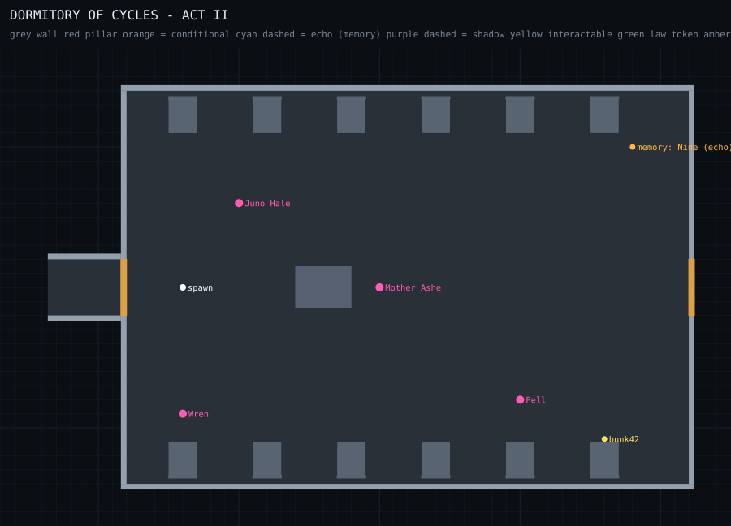
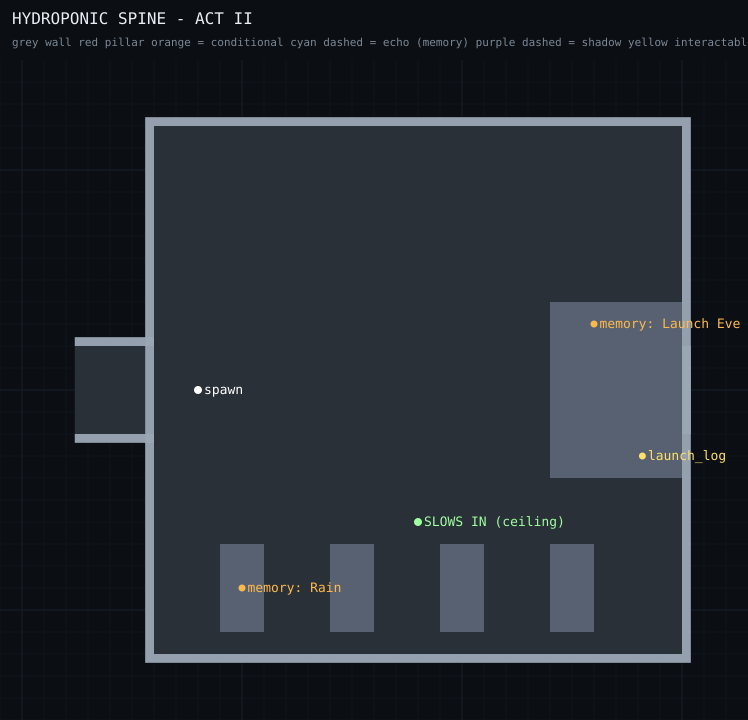
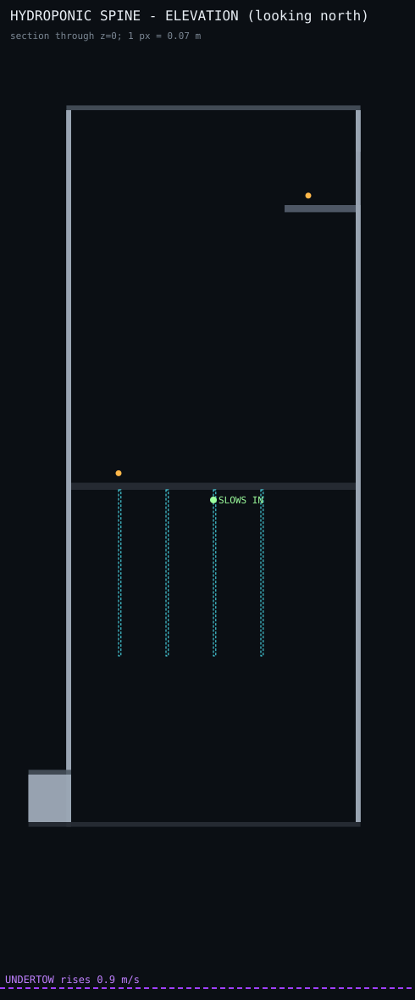
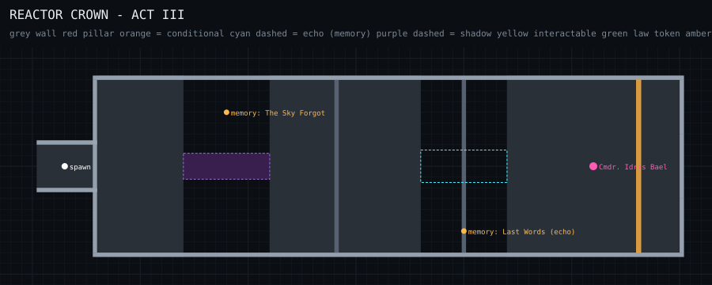
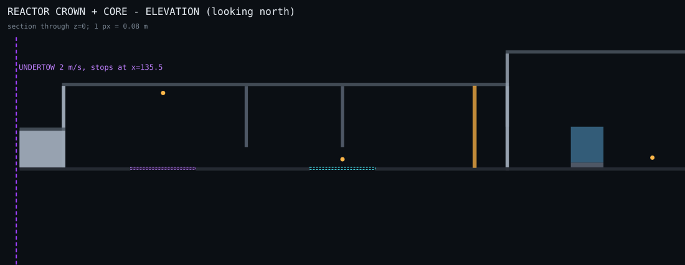

# AFTERZERO — World & Maps (Unity version)

Eight connected zones, about **245 m end to end and 60 m tall**: roughly 6× the prototype's playable area. Every plan below is **rendered straight from the game's level data** (`unity/Tools/MapExport`), so the maps can't drift from what's built.

Regenerate after editing `WorldContent.cs`:

```bash
cd unity/Tools/MapExport && dotnet run -- ../../../docs/unity/maps
```

Legend: grey = wall/furniture · red = Observer cover pillar · orange = conditional (doors, barriers) · cyan dashed = echo (memory-geometry) · purple dashed = shadow geometry · yellow = interactable · green = law token · amber = memory fragment · pink = character · white = spawn/checkpoint.

## The vessel



| Zone | Size (m) | Act | Role | New idea it teaches |
|---|---|---|---|---|
| Cradle | 10 × 10 × 5 | I | Start | Touching the object changes the room; a door that exists only inverted |
| Laboratory | 32 × 32 × 12 | I–III | Hub, changes meaning | Shifting, ECHO, the shadow, law rewriting, memory into reality |
| Observation Hall | 48 × 24 × 10 | I | Stealth | An enemy that learns your habits |
| Archive | 28 × 34 × 9 (+8 m pit) | I | Contradiction | Characters believe evidence, not words; solid memories |
| Dormitory of Cycles | 40 × 28 × 6 | II | Safe hub with people | Dialogue choices, side quests, belonging |
| Hydroponic Spine | 24 × 24 × **60** | II | Vertical chase | Falling up, falling down where you want to land |
| Reactor Crown | 54 × 16 × 10 at y=52 | III | Horizontal chase | Floor vs. ceiling vs. memory, under pressure |
| The Core | 22 × 20 × 14 | III | Finale | The choice |

## Act I

### Cradle


The seal on the north wall exists in every state except INVERTED. The corridor belongs to the Cradle (it shares its state), so the player walks out along the corridor ceiling and drops 4 m into the lab.

### Laboratory (hub)


- **Shadow passage** (east wall, south): the shadow mirrors your z position; stand at z ≈ +8 and shift to ECHO so it stands on the door outline at z ≈ −8.
- **Ceiling alcove** (north-west, 11 m up): `PERSISTS THROUGH` and the memory *Halo*.
- **Memory key** on the desk exists only in ECHO; the archive panel only accepts it in PHYSICAL.
- **Dormitory door** (east) is sealed until the lockdown; Juno cuts it open.
- After activation, the east and south walls are glass and space is outside.

### Observation Hall


15 full-height pillars, three learnable lanes, the core at the far end, "17 WAS HERE" carved into a pillar (ECHO only) for Pell's side quest, and the memory *Hide and Seek* on the ceiling.

### Archive


The 8 m gap is crossed only on memory (`ECHOES SOLIDIFY IN …`), because hanging stacks block the ceiling route. Falling returns you to the entrance.

## Act II

### Dormitory of Cycles


Twelve bunks numbered with cycles (9, 17, 30… and 42, already made up for you). Ashe, Pell, Wren and Juno live here. Warm light, no threats: it's the breather between the two big chases.

### Hydroponic Spine



1. Enter at the bottom. The Undertow starts rising from 14 m below the floor at 0.9 m/s.
2. Invert: fall **up** 27 m onto the underside of the hydroponic tray.
3. Run along the underside to the gap in the north-east corner (`SLOWS IN` is on the way).
4. Fall up through the gap to the ceiling at 60 m.
5. Walk until you're over the landing, shift to PHYSICAL, and fall **down** onto it.
6. Read Varga's launch log; TICK says your name on the way up.

## Act III

### Reactor Crown and the Core



The Undertow advances along the corridor at 2 m/s and **un-happens the geometry behind it** (floor slabs and walls disappear). The sections alternate deliberately:

| x (m) | Section | How to cross |
|---|---|---|
| 96–104 | Floor | Run |
| 104–112 | **Gap 1** | Invert and cross on the ceiling, **or** carry `SHADOWS` and write `SHADOWS SOLIDIFY IN …` to walk the shadow bridge |
| 112–126 | Floor, hanging stack at 118 | Must be PHYSICAL to pass under the stack |
| 126–134 | **Gap 2**, ceiling blocked at 130 | Only memory crosses: `ECHOES SOLIDIFY IN …` |
| 136 | Field anchor | The Undertow stops here |
| 136–146 | Bael | Show the launch log, or survive 25 s of Wardens |
| 150+ | The Core | Varga, the brain, the Observer, the choice |

`TIME SLOWS IN <state>` halves the Undertow in rooms in that state; `UNDERTOW FREEZES IN <state>` stops it. Players who explored get easier chases, and that is the reward for exploring.

## Level-design rules

1. **One new idea per zone, then combine.** The Crown uses every mechanic in sequence.
2. **Every state of every room is worth visiting.** ECHO always shows something; ceilings always hold something.
3. **Breathers between spikes.** Hall (tense) → Archive (calm) → Lockdown (spike) → Dormitory (safe) → Spine (spike) → Crown (spike) → Core (quiet).
4. **No dead ends.** Falls and catches return you to a checkpoint seconds away; chases restart cleanly.
5. **Reuse and re-light.** The lab changes meaning four times; that costs less than four new rooms.
6. **Greybox first, art second.** All geometry is data; artists replace materials and props through a `WorldTheme` asset without touching gameplay.
